DengueGuard AI — System Architecture
System architecture

```mermaid
flowchart LR
    subgraph DF["01 DATA FOUNDATION"]
        A["Historical ward data<br/>Weekly dengue records<br/>Weather history"]
        B["Feature pipeline<br/>Ward-week aggregation<br/>38 engineered input features"]
        C["Preprocessing assets<br/>Saved preprocessors<br/>Consistent inference inputs"]
        A --> B --> C
    end

    subgraph MC["02 MODEL CORE"]
        D["Offline training<br/>Train → Save"]
        E["2-week horizon<br/>Advanced CatBoost"]
        F["4-week horizon<br/>Advanced LightGBM"]
        D --> E
        D --> F
    end

    subgraph DL["03 DELIVERY LAYER"]
        G["Runtime data & models<br/>Excel dataset<br/>CatBoost + LightGBM model files"]
        H["Flask API<br/>GET /api/options<br/>POST /api/predict"]
        I["Browser dashboard<br/>HTML / CSS / JavaScript<br/>Select ward, week & horizon"]
        G --> H
        H <--> I
    end

    C --> D
    E --> G
    F --> G

    subgraph RC["REQUEST CYCLE"]
        J["1. User input<br/>City · ward · horizon"]
        K["2. API inference<br/>Load model · predict"]
        L["3. Forecast output<br/>JSON → dashboard"]
        J --> K --> L
    end

    I -. "Selects forecast options" .-> J
    K -. "Uses Flask prediction endpoint" .-> H
```

Feature pipeline and model selection
The pipeline follows the supplied notebook. It sorts by `city`, `ward_id` and date, creates 2- and 4-week future dengue targets, dengue case lags (1, 2, 4, 8, 12 and 52 weeks), dengue rolling means (4, 8 and 12 weeks shifted by one row), rainfall rolling sums (2 and 4 weeks), shifted rainfall rolling means (4 and 8 weeks), weather lags (1 and 2 weeks), month/week-of-year and cyclical week encodings, plus temperature/humidity/rainfall interaction terms. The resulting model matrix has 38 features: the notebook's 25 original features and 13 advanced additions.
The notebook selected Advanced CatBoost for the 2-week target and Advanced LightGBM for the 4-week target. The website preserves their parameters: CatBoost (500 iterations, depth 6, learning rate 0.05, RMSE loss, L2 leaf regularization 3, seed 42); LightGBM (500 estimators, 31 leaves, learning rate 0.05, subsample and column sample 0.8, L1 0.1, L2 1, seed 42). Categorical `city` and `ward_id` values are one-hot encoded with unknown categories ignored; numeric features pass through. Each preprocessor is fit on its horizon's training partition only.
Chronological validation
For each target horizon, the notebook splits unique observation dates into the earliest 70% train, next 15% validation, and latest 15% test. It restricts training rows so their target date falls before the train end and validation rows so their target date remains before the validation end. The web training pipeline retains these rules. Test and validation MAE, RMSE, and R² are recalculated at model build time and exposed to the dashboard; the repository's existing `final_ml_model_performance.csv` is retained as the notebook's reported result.
Risk categories
The supplied notebook thresholds mark P75 as Moderate and P90 as High. To meet the four-tier requirement while preserving those cutoffs, the UI labels below P75 Low, P75–P90 Medium, P90–P95 High, and P95 or above Critical. P95 is calculated from the horizon's training target. Tiers are relative priority labels, not calibrated outbreak probabilities or clinical thresholds.
Compute and API cost controls
No live weather, geocoding, hosted model, or LLM API is called. The supplied workbook is the data source.
Model training is run once by `python backend/train_models.py`; estimators and preprocessors are serialized with joblib and loaded once when the API starts serving requests.
The engineered dataset is cached in process memory. A ward prediction and city watchlist use local model inference without retraining or external requests.
The LLM is not in the inference path; token usage and LLM API cost are zero.
Limitations
The bundled dataset is a historical snapshot through December 2025, with no future meteorological feed. Forecasts are scenarios based on the selected observation week and optional current-week weather edits. Model metrics and risk tiers should be interpreted against the held-out time period and reviewed by public-health partners before operational use.
